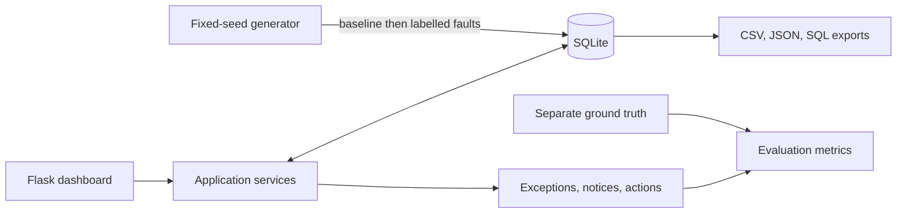

# ColdChain Guardian

**A local cold-chain monitoring demo for tracking shipment conditions, detecting excursions, and preserving operational evidence.**

ColdChain Guardian simulates temperature and humidity readings over shipment journeys. It applies effective-dated product policies, records exceptions with evidence, tracks route and custody history, and reports validation and evaluation metrics.

> **Demo only:** All records and policy values are synthetic. This project is not a validated quality system and must not be used to make product handling or safety decisions.

## Contents

- [Features](#features)
- [Quick start on Windows](#quick-start-on-windows)
- [Generate data](#generate-data)
- [Run tests and validation](#run-tests-and-validation)
- [How it works](#how-it-works)
- [Data and exports](#data-and-exports)
- [Application pages and API](#application-pages-and-api)
- [Project structure](#project-structure)
- [Scope and limitations](#scope-and-limitations)

## Features

- Temperature and humidity monitoring for shipments and storage containers.
- Product-specific, effective-dated threshold policies and excursion-duration rules.
- Detection of brief and prolonged excursions, physical-range faults, sensor gaps, calibration failures, and route delays.
- Evidence-backed exceptions, notifications, and corrective actions.
- Shipment lifecycle, route-stop, and append-only custody history.
- Dashboard, shipment and route views, excursion review, reports, and CSV/JSON exports.
- Deterministic synthetic data, separate ground-truth labels, validation checks, and reproducibility reports.

## Quick start on Windows

Open PowerShell in the project folder and run:

```powershell
py -3.12 -m venv .venv
.\.venv\Scripts\Activate.ps1
python -m pip install -r requirements.txt
python generate_data.py --scale starter --seed 20261022
python app.py
```

Then open [http://127.0.0.1:5000](http://127.0.0.1:5000). Keep the terminal open while using the app; press **Ctrl+C** to stop it. The local demo does not require a user login.

## Generate data

The generator resets the local SQLite demo database each time it runs. Do not point it at operational data.

```powershell
# Small dataset for local use
python generate_data.py --scale starter --seed 20261022

# Full problem-statement volume: 1,000 shipments and 300 containers
python generate_data.py --scale full --seed 20261022

# Also export a portable SQL seed
python generate_data.py --scale starter --seed 20261022 --sql
```

Readings are generated every five minutes over two-to-five-day planned trips. Active shipments stop at their current observation horizon; delayed completed trips include readings through actual arrival. Valid baseline records are staged before deterministic edge cases are applied.

## Run tests and validation

```powershell
python -m pytest -q
```

The project also generates `data/generated/validation_summary.json`, `validation_report.csv`, and `evaluation_summary.json`. Validation covers keys and joins, reading assignments and trip windows, physical ranges, lifecycle and custody chronology, route ordering, policy dates, excursion evidence, detected gaps, and export consistency. The current starter dataset passes **20/20 checks**; the test suite contains **15 tests**.

GitHub Actions runs the test suite on pushes and pull requests to `main`.

## How it works



The detector uses source records and product policies; it never reads the ground-truth files. Ground truth is used only for post-detection evaluation. A positive event matches a stored detection by shipment, sensor, event kind, and start time. The full-scale evaluation reports **588 true positives, zero false positives, and zero false negatives** for the fixed seed. True negatives are unavailable because the project does not label every safe five-minute interval.

The full-scale generator creates **1,000 shipments, 300 containers, 600 sensors, and 1,812,402 readings**. Two full runs with seed `20261022` produced matching output checksums. See [`docs/REPRODUCIBILITY_REPORT.md`](docs/REPRODUCIBILITY_REPORT.md) for hashes and run details.

## Data and exports

Core entities are `Product`, `Shipment`, `Container`, `Sensor`, `SensorReading`, `RouteStop`, `ThresholdPolicy`, `Excursion`, `CustodyEvent`, and `CorrectiveAction`. Supporting tables include `ContainerAssignment` for shipment/container assignment history, `LifecycleEvent` for state history, and `Notification` for alerts.

- Schema: [`database/schema.sql`](database/schema.sql)
- Field-level dictionary and relationships: [`docs/DATA_DICTIONARY.md`](docs/DATA_DICTIONARY.md)
- Business rules: [`docs/BUSINESS_RULES.md`](docs/BUSINESS_RULES.md)
- Validation results: [`docs/VALIDATION_REPORT.md`](docs/VALIDATION_REPORT.md)
- Independent labels: `data/generated/ground_truth.csv` and `ground_truth.json`
- Generated source exports and hashes: `data/generated/` and `data/source_manifest.json`

Generated databases, exports, virtual environments, and local secrets are excluded from Git. Generate the starter records after cloning to recreate them. The optional SQL seed is also generated on demand with `--sql`.

## Application pages and API

The application provides Overview, Shipments, Live Monitoring, Route Tracking, Excursions, Corrective Actions, Custody History, and Reports & Exports pages.

Key endpoints include:

- `GET /api/dashboard`, `/api/shipments`, `/api/readings`, `/api/routes`, `/api/excursions`, `/api/actions`, `/api/metrics`, `/api/validation`
- `POST /api/detect` to run detection
- `PATCH /api/shipments/<id>/status` to record a lifecycle transition
- `POST /api/shipments/<id>/custody` to append a custody event
- `PATCH /api/actions/<id>` to update a corrective action
- `GET /api/export/<table>.csv` and `/api/export/<table>.json` to export records

## Project structure

```text
app.py                  Flask application and API routes
database/               SQLite schema
generator/              Deterministic data and SQL-seed generation
services/               Detection, lifecycle, metrics, and validation rules
static/ and templates/   Dashboard assets and pages
tests/                  Automated test suite
docs/                   Data dictionary, business rules, and reports
```

## Scope and limitations

This is an educational local demo. It has no authentication, role-based access, hardware ingestion, or production deployment. Product policies and sensor values are fabricated examples, not real handling guidance. Flask runs in development mode. Charts use an optional Chart.js CDN; the local backend and records continue to work without it.
